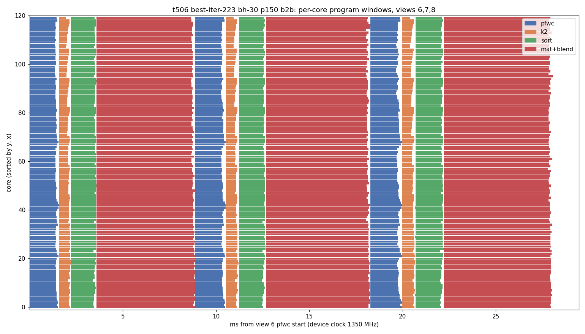

# t506: p150 back-to-back device timeline at best-iter-223

Task #506, 2026-10-11 (PDT). Build best-iter-223 (5ca019ae), defaults, bicycle 30 views,
`render/run.py --back-to-back` (no `--dump-views`). Box: bh-30 (p150b, 12x10 = 120 worker cores,
eth dispatch), run under the 2026-10-07 viewer exception (no free non-viewer p150); the viewer
was stopped only for the bench and restarted after it (localhost:8091 answered 200).

## Headline

| run | ms/view (mean / median) | raw_md5 | xview hits / misses |
|---|---|---|---|
| untraced u1 (20 passes) | 8.781 / 8.777 | d9a60a3c | 659 / 0 |
| untraced u2, drift round 1 (one 9.78 pass) | 8.840 / 8.789 | d9a60a3c | 0 misses |
| untraced u2, drift round 2 (after the Tracy chunks) | 8.800 / 8.789 | d9a60a3c | 0 misses |
| Tracy device timeline, steady periods (15) | 8.753 (device clock) | - | - |
| Tracy + `GSPLAT_TT_MATCULL_PROF=1` (9 periods) | 8.914 (device clock) | - | - |

Profiler overhead is within noise for the plain Tracy build (8.753 vs 8.78); the MATCULL zones
add about 0.16 ms. The device hero (u1) has PSNR 42.51 dB against `benchmarks/reference_v2/hero.png`
(`hero.png`, x10 diff `hero_diff10.png`). I looked at the diff: differences sit only on edges,
with no tile artifacts.

**The device is busy almost the whole period.** The steady period is 8.753 ms; the four program
windows add up to 8.687 ms, so all-core idle (no core runs anything) is 0.066 ms/view. The host is
not on the critical path in b2b mode (host residue `py_resid` 0.055 ms).

## AI clock: 1350 MHz under load

- The profiler header (`CHIP_FREQ[MHz]`, read from the ARC with the device open) says 1350 in
  all 9 chunks.
- Device cycles converted at 1350 MHz give an 8.753 ms period; the host clock measures 8.78 ms.
- A fixed instruction loop has the same cycle count as in t319 (2026-10-07): TRISC2 patch
  18.70 cycles/record now vs 18.65 then. At 800 MHz with a fixed-rate counter it would read ~31.6.
- sysfs `tt_aiclk` reads 800 in 95% of the 0.1 s samples, even mid-bench, with a few 1350 bursts
  (out2/aiclk.txt). It does not track the clock under load; #493's "aiclk 800 on bh-30" came
  from it. No 800 MHz alert is needed.

## Where the 8.75 ms goes (steady views, ms/view)

Window = first core start to last core end. All cores start each program together (start spread
0.000: go-signal multicast), so the idle inside a window is the end spread (load imbalance).

| program | window | mean core busy | slowest core | end spread (idle/core) | share of period |
|---|---|---|---|---|---|
| pfwc (project + gather, CQ1) | 1.614 | 1.452 | 1.614 | 0.162 | 18% |
| k2 (pairs/rows) | 0.617 | 0.503 | 0.617 | 0.113 | 7% |
| sort (sort_ol town/emit) | 1.327 | 1.252 | 1.327 | 0.075 | 15% |
| mat+blend | 5.223 | 5.076 | 5.222 | 0.146 | 59% |

Boundaries (`steady506.py`):

| boundary | all-core idle (mean / max) | per-core idle (mean core / worst core) | cause |
|---|---|---|---|
| pfwc -> k2 | 0.008 / 0.008 | 0.166 / 0.253 | pfwc end spread; dispatch gap ~8 us |
| k2 -> sort | 0.014 / 0.015 | 0.128 / 0.255 | k2 end spread; dispatch ~14 us |
| sort -> mat+blend | 0.045 / 0.332 | 0.121 / 0.246 | 22 of 25 views ~10 us; 3 views (3, 4, 24) 0.22-0.33 ms where the mat program reached the cores late. Host zones are not in this build, so host publish late (`sort_publish_host` 0.365 ms) is the likely cause, not proven |
| mat+blend N -> pfwc N+1 | 0.015 / 0.018 | 0.163 / 0.271 | blend end spread; dispatch ~15 us |
| **sum** | **0.083** | **0.578** | |

Inside mat+blend (per core, mean / max over cores): mat 1.539 / 2.101, blend `tile_blend_sfpu`
3.403 / 3.744, 9.2 blend jobs per core. TRISC1 is idle 0.58 ms (max 1.23) of the mat phase:
0.39 ms at mat start waiting for the first job (movers in `mat_ol_sort` 70% of that time),
0.18 ms between jobs, ~0 at the tail (`out2/anaM/ana506.txt`, section (c)).

Per-view Gantt, views 6-8, all 120 cores: `gantt-v6-8.png`.

## Lever bounds (measured upper bounds, ms/view)

| lever | bound | clears 0.15? | basis |
|---|---|---|---|
| (a) pfwc N+1 fills the mat+blend N tail | **0.162** | just, as an upper bound | blend end spread 0.146 + all-core gap 0.015. Only reachable if pfwc N+1 starts per core as each core finishes blend N. Two programs on the same cores do not overlap today (0 per-core overlaps): the go signal for the CQ1 pfwc waits for every core. A real build needs pfwc fused into the blend kernel's tail or a per-core start, and pfwc's own 0.16 end spread then moves to the pfwc -> k2 boundary. Realistic gain is well under 0.16. |
| (b) summed inter-program idle (all-core) | **0.083** | no | dispatch gaps of 8-15 us per boundary plus the 3 late mat starts. The per-core boundary idle is 0.578, but that is end spread and needs program overlap (the (a) mechanism at all 4 boundaries) to reclaim. |
| (c) mat fill jobs + big-tile split | **0.209-0.220** (x0.28), ceiling 0.236 | yes | `docs/fill-model-t335/model.py` re-run on this capture (`out2/anaM/percore.csv`, 14 views): mat makespan 2.056 ms; realistic combined (2 chunks, dup 0.15) mat 1.269-1.310, gain 0.746-0.787 model ms, x0.28 = 0.209-0.220, x0.4 = 0.298-0.315. Big-tile split alone: 0.122-0.131 (x0.28). Finer jobs alone without rank-ordered gather: ~0. |

Against t335 (t319 data, 2026-10-07): mat makespan fell from 2.675 to 2.056 ms, and the
realistic combined gain grew from 0.650 to 0.787 model ms. The critical cores are still the
pure-big ones (cores 1-2 .. 6-2, NCRISC holding one >8192-record item). The t335 gate (x0.4
>= 0.30) now says BUILD (0.315); at x0.28 it is 0.22.

## Other bubbles >= 0.1 ms/view

- **TRISC1 idle at mat start, 0.39 ms per core** (waiting for the movers' first sort). If every
  core filled its mat idle with its own blend work, the slowest core's mat+blend falls by 0.51 ms
  (`ana506` (a), `out2/anaP/ana506.txt`); whole blend jobs only fit 0.06 ms of it. This is the
  same idle (c) attacks from the mover side, so the two do not add up.
- **pfwc end spread 0.162** and **k2 end spread 0.113**: load imbalance inside those programs.
  Better balance inside pfwc, or k2 starting per core, would reclaim part of it.
- Blend itself, 3.40 ms/core of SFPU (`tile_blend_sfpu`), is 39% of the period: the FPU
  quadratic-form blend lever (<= 0.7 ms, changes the image) targets this.

## Files

- `bench506.sh`, `drive506.sh`: device bench (untraced round, Tracy chunks P0..P25 through the
  #427 profiler eth overlay `ttm-eth12p36`, MATCULL chunks M0/M10/M20, drift round).
- `prep506.py`: joins chunk CSVs, keeps the 5 measured views per chunk.
- `ana506.py`: per-program windows, zones, boundaries, mat/blend split, job gaps.
- `steady506.py`: steady-view accounting (drops the pass-boundary pause), bounds, Gantt.
- `out/`: first run (u1, u2 drift, first Tracy chunks that failed on the default 32 KB ETH
  overlay, `out/failed-tracy`). `out2/`: the Tracy rerun (dev-*.csv.gz, T-*.log, aiclk.txt,
  drift u2) and the analyses `anaP/` (plain Tracy) and `anaM/` (MATCULL zones, fill_zones,
  fill model).
- The raw device CSVs (`out2/dev-*.csv.gz`, `out2/tracy-u-*.csv.gz`, 57 MB) are not committed;
  they stay in the task worktree `tt-project/state/runs/1393/wt/docs/b2b-timeline-p150-223/out2/`
  on the Mac and in `tmp/t506-*` of the bh-30 bench tree.
- Chunk P20 lost core column x=16 in its profiler readout (110 of 120 cores) and is dropped:
  the plain analysis covers views 0-19 and 25-29.

Reproduce: `python3 prep506.py -o p.csv.gz out2/dev-P{0,5,10,15,25}.csv.gz;
python3 steady506.py p.csv.gz --gantt g.png --gantt-views 6,7,8`.
